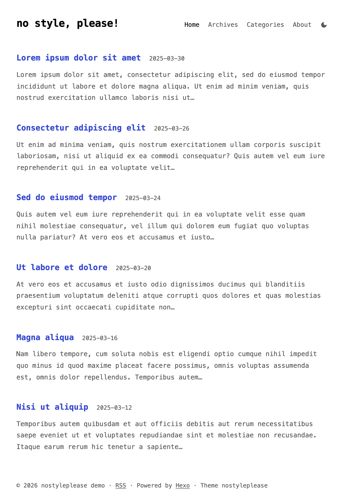
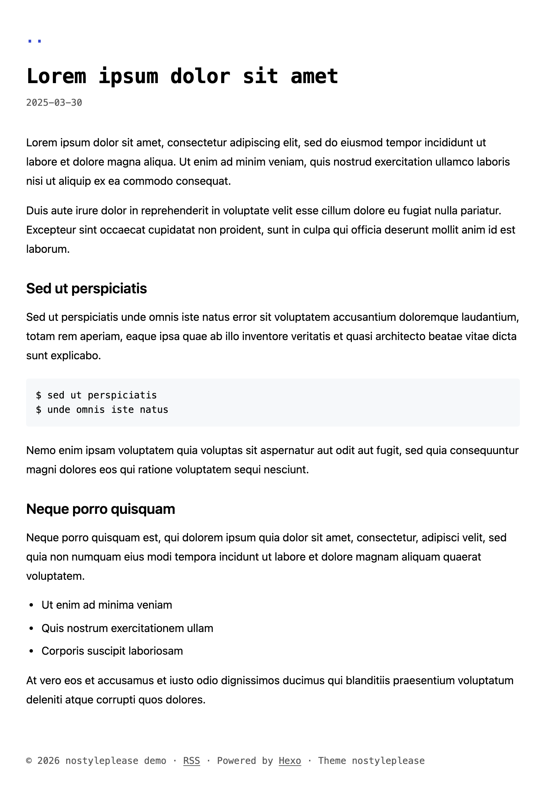
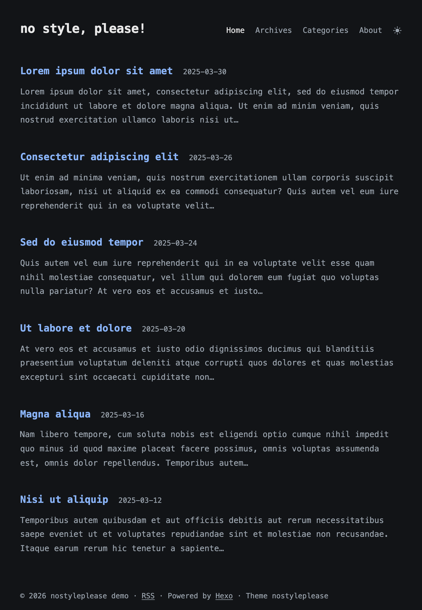

# no style, please!

<p align="center"><a href="README.en.md">English</a> · <a href="README.md">中文</a></p>

<p align="center">
  <a href="https://github.com/hexojs/hexo"></a>
  <a href="LICENSE"></a>
  <a href="https://github.com/HBUzxl/hexo-theme-nostyleplease/stargazers"></a>
</p>

<p align="center">
  
  
  
</p>

A Hexo port of [hugo-theme-nostyleplease](https://github.com/Masellum/hugo-theme-nostyleplease), which is itself a port of [riggraz/no-style-please](https://github.com/riggraz/no-style-please).

## What this port adds

The original theme is a single column of text: no images, no borders, no layers. That part is unchanged. What was added:

- **Site structure**: a masthead with the site title and a nav menu on the home page, plus archive, category, tag and 404 pages.
- **Posts get out of the way**: no nav on article pages, only a `..` link in the top left. It goes back in history when you came from the same site, and to the home page otherwise.
- **Dark mode**: follows the system by default, a button in the nav switches it, the choice is stored in `localStorage`.
- **Chinese typesetting**: automatic spacing between CJK and Latin text, a 716px measure, dates that don't wrap.
- **Images**: a paragraph containing only an image becomes a `<figure>`; the Markdown title becomes the caption below it; images are lazy-loaded.
- **Reading extras**: table of contents (`toc: true`), collapsible blocks (``), MathJax loaded only when a post asks for it.
- **Feed and SEO**: canonical and Open Graph tags and a post-processing step that turns relative URLs in the feed into absolute ones.
- **Size**: about 9 KB of CSS. No CSS framework, no web fonts, no third-party requests.

## Quick start

```bash
cd your-blog
git clone https://github.com/HBUzxl/hexo-theme-nostyleplease.git themes/nostyleplease
```

Then in the site's `_config.yml`:

```yaml
theme: nostyleplease
language: en
```

RSS is optional and needs [hexo-generator-feed](https://github.com/hexojs/hexo-generator-feed):

```bash
npm install hexo-generator-feed
```

The theme post-processes the generated feed: relative links are made absolute, and `loading` / `decoding` attributes are dropped, since readers have no use for them.

## Configuration

Don't edit `themes/nostyleplease/_config.yml` — an update will overwrite it. Copy it to the site root as `_config.nostyleplease.yml` and edit that:

```bash
cp themes/nostyleplease/_config.yml _config.nostyleplease.yml
```

```yaml
# characters kept in the excerpt on the home page
excerpt_length: 200

# text of the back link on posts; empty to hide it
back_text: ".."

# nav menu
nav:
  home: { url: / }
  archives: { url: /archives/ }
  categories: { url: /categories/ }
  about: { url: /about/, title: About }

# footer text, Markdown allowed
footer: "Powered by [Hexo](https://hexo.io/)"
```

## Writing

Front-matter:

```yaml
---
title: A post
date: 2025-03-30 10:00:00
toc: true                 # floating table of contents
mathjax: true             # load MathJax for this post
custom_js: [my-script]    # load source/js/my-script.js
---
```

An image on its own line is wrapped in a `<figure>`, and its title becomes the caption:

```markdown

```

Collapsible content, no plugin needed:

```markdown

Hidden by default.

```

## Languages

`zh-CN` and `en` are included; anything else falls back to `default.yml`. To add a language, copy `languages/en.yml` to `languages/ja.yml` (or whatever the code is) and translate the strings.

## License

This project is open source under the [MIT License](LICENSE). Free to use and modify.
