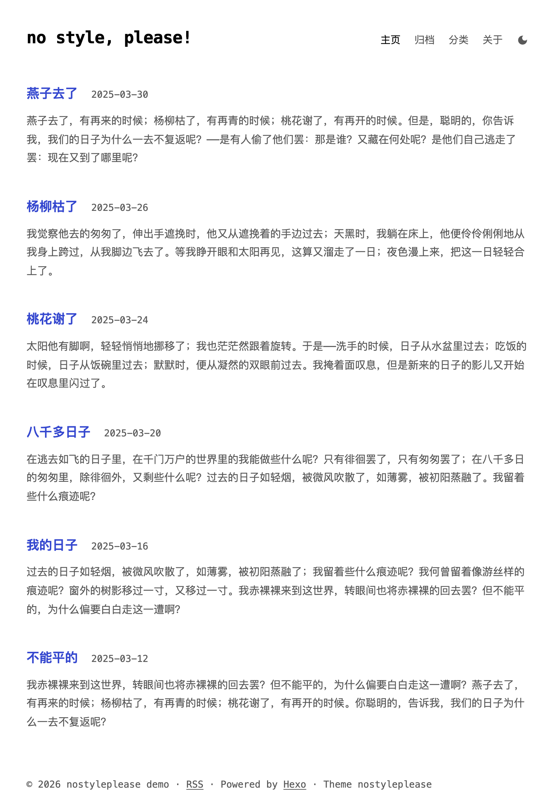
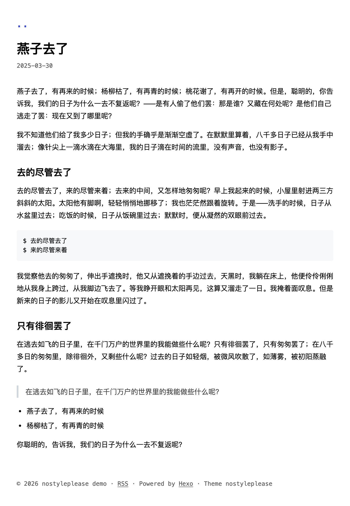
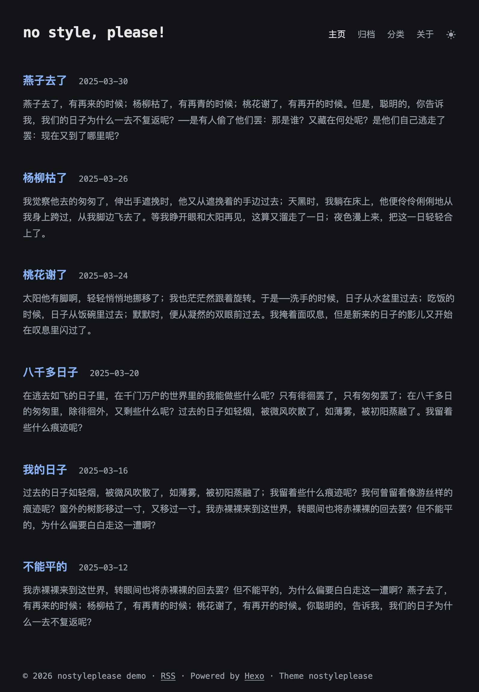

# no style, please!

<p align="center"><a href="README.en.md">English</a> · <a href="README.md">中文</a></p>


<p align="center">
  <a href="https://github.com/hexojs/hexo"></a>
  <a href="LICENSE"></a>
  <a href="https://github.com/HBUzxl/hexo-theme-nostyleplease/stargazers"></a>
</p>


<p align="center">
  
  
  
</p>


> 💡 移植自 Hugo 同名主题 [hugo-theme-nostyleplease](https://github.com/Masellum/hugo-theme-nostyleplease)，原设计来自 [riggraz/no-style-please](https://github.com/riggraz/no-style-please)。


## ✦ 为什么选择它？

现在的网页越来越重：庞大的 CSS 框架、繁复的 Web 字体、各种炫目的浮窗动画……但博客的本质，应该是**文字本身**。

`no style, please!` 选择了极端的反向路线——**去掉一切不必要的视觉干扰**。

原版设计极其纯粹，但作为独立博客略显简陋，在继承其原有风格的同时，新增了一些功能并增强了中文的阅读体验：

* 🪶 **极致轻量** — 仅 **9 KB** 原生 CSS，零第三方框架，零外部字体资源请求。
* 🗂️ **补齐站点结构** — 新增顶部导航栏、归档/分类/标签页与 404 页。   
* 📖 **专注阅读** — 文章详情页**隐藏所有导航菜单**，只在左上角保留一个轻量的 `..` 返回上一级。
* 🌗 **暗色模式** — 主题跟随系统配色，支持一键手动切换，并自动记忆偏好。
* ✍️ **注重文本** — 内置中英文自动空格、代码高亮、移动端适配、自适应 `<figure>` 图注与懒加载。
* 🛠️ **功能克制** — 按需加载 MathJax 数学公式，阅读界面提供悬浮目录。


## 🚀 快速开始

### 1. 克隆主题

进入你的 Hexo 博客根目录：

```bash
git clone https://github.com/HBUzxl/hexo-theme-nostyleplease.git themes/nostyleplease
```

如果需要 RSS 订阅功能，需要安装 [hexo-generator-feed](https://github.com/hexojs/hexo-generator-feed) 插件：

```bash
npm install hexo-generator-feed
```

### 2. 应用主题

修改站点根目录的 `_config.yml`：

```yaml
theme: nostyleplease
language: zh-CN  # 可选: zh-CN, en
```

## ⚙️ 配置文件

为了防止后续更新主题时覆盖掉你的自定义配置，**请勿直接修改 `themes/nostyleplease/_config.yml`**。

请将主题目录下的 `_config.yml` 复制一份到**博客根目录**，并重命名为 `_config.nostyleplease.yml`：

```bash
cp themes/nostyleplease/_config.yml _config.nostyleplease.yml
```

常用配置项一览：

```yaml
# 首页文章列表摘要截取长度
excerpt_length: 200

# 文章详情页左上角返回按钮文本（留空则不显示）
back_text: ".."

# 顶部导航菜单
nav:
  home: { url: / }
  archives: { url: /archives/ }
  categories: { url: /categories/ }
  about: { url: /about/, title: "关于" }

# 页脚文本 (支持 Markdown)
footer: "Powered by [Hexo](https://hexo.io/)"
```


## 📝 写作技巧与彩蛋

### 文章 Front-matter 配置

```yaml
---
title: 燕子去了
date: 2025-03-30 10:00:00
toc: true                   # 开启右侧悬浮目录
mathjax: true               # 按需加载 MathJax 公式
custom_js: [my-script]      # 加载 source/js/my-script.js
---
```

### 自动排版与图注

当 Markdown 中的图片**单独成段**且包含标题时，主题会自动将其包裹为 `<figure>` 并将 `title` 渲染为下方居中的灰色图注：

```markdown

```

### 原生折叠块

无需任何复杂插件，直接在 Markdown 中使用：

```markdown

这里是默认折叠隐藏的文本。

```


## 🌐 语言支持

目前内置支持 `zh-CN` 与 `en`。如需添加新语言，只需在 `themes/nostyleplease/languages/` 下复制 `en.yml` 并修改为对应语言代码（如 `ja.yml`）即可。


## 许可

本项目基于 [MIT License](LICENSE) 开源，欢迎自由使用或二次修改。
